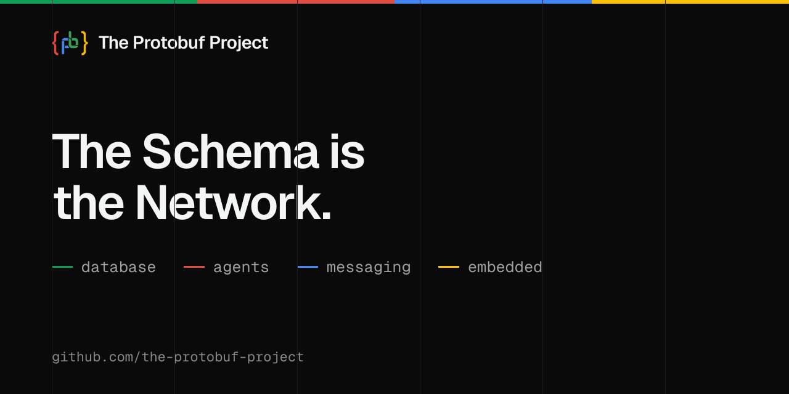

  <a href="https://the-protobuf-project.org"><b>Website</b></a> ·
  <a href="https://the-protobuf-project.org/ecosystem">Ecosystem</a> ·
  <a href="https://the-protobuf-project.org/blogs">Blogs</a> ·
  <a href="https://the-protobuf-project.org/editor">Editor</a> ·
  <a href="https://the-protobuf-project.org/announcements">Announcements</a> ·
  <a href="https://the-protobuf-project.org/contributors">Contributors</a>

## The schema is the network

**The Protobuf Project** turns one AIP-annotated `.proto` into the systems around it: MCP servers
and Code Mode APIs for AI agents, the database and its migrations, REST gateways and service
layers, message brokers, and embedded wire formats. Generated for Go, Rust, and TypeScript, from
the schema you already maintain.

- **Describe it once.** Protocol Buffers annotated with Google's [API Improvement Proposals](https://google.aip.dev).
- **Generate the rest.** `protoc` and `buf` plugins write the code; shared runtimes carry it.
- **See it first.** The [editor](https://the-protobuf-project.org/editor) shows every plugin's real output for one schema.

## Projects

### Agents

| Project | What it does |
| --- | --- |
| [**codemode**](https://github.com/the-protobuf-project/codemode) · [docs](https://the-protobuf-project.org/ecosystem/codemode) | Protoc plugin generating typed, sandboxed Code Mode APIs from gRPC protos: AI agents write TypeScript instead of tool calls. |
| [**mcp**](https://github.com/the-protobuf-project/mcp) · [docs](https://the-protobuf-project.org/ecosystem/mcp) | Your APIs, ready for AI. Generate fully compliant MCP servers in Go, Rust, and C++ straight from your .proto files. |

### Databases

| Project | What it does |
| --- | --- |
| [**cache**](https://github.com/the-protobuf-project/cache) · [docs](https://the-protobuf-project.org/ecosystem/cache) | Read-through caching, generated from your protos. Typed, tenant-safe, and invisible to callers. In Go and Rust. |
| [**store**](https://github.com/the-protobuf-project/store) · [docs](https://the-protobuf-project.org/ecosystem/store) | One schema. Every database. Generate the persistence layer for Go, Rust, TypeScript, and SQL from a single set of protos. |
| [**web3**](https://github.com/the-protobuf-project/web3) · [docs](https://the-protobuf-project.org/ecosystem/web3) | One schema, every chain. Compile your protos to Solidity on EVM, Anchor on Solana, and chaincode on Hyperledger Fabric. |

### Messaging

| Project | What it does |
| --- | --- |
| [**http**](https://github.com/the-protobuf-project/http) · [docs](https://the-protobuf-project.org/ecosystem/http) | REST, done right. An AIP-native HTTP/JSON gateway for gRPC services, generated from your annotations for Go and Rust. |
| [**service**](https://github.com/the-protobuf-project/service) · [docs](https://the-protobuf-project.org/ecosystem/service) | Your AIP service layer, written for you. Standard methods, validation, and wiring — generated in Go and Rust from the protos you already have. |

### Embedded

| Project | What it does |
| --- | --- |
| [**buffers**](https://github.com/the-protobuf-project/buffers) · [docs](https://the-protobuf-project.org/ecosystem/buffers) | One schema, every wire format. Turn AIP protos into FlatBuffers, Cap'n Proto, Thrift, ROS 2, and Wire — with fields that never move. |

### Foundations

| Project | What it does |
| --- | --- |
| [**protokit**](https://github.com/the-protobuf-project/protokit) · [docs](https://the-protobuf-project.org/ecosystem/protokit) | The foundation for every generator. Parse protos once into a clean intermediate representation, then focus on what you render. |
| [**resourcename**](https://github.com/the-protobuf-project/resourcename) · [docs](https://the-protobuf-project.org/ecosystem/resourcename) | AIP resource names, everywhere. Parse and build them from one template in Go, Rust, Python, TypeScript, Swift, and C. |
| [**runtime-go**](https://github.com/the-protobuf-project/runtime-go) · [docs](https://the-protobuf-project.org/ecosystem/runtime-go) | The Go runtime beneath every generated service. One interface per job, a driver for every backend. Switch databases or brokers by changing one line. |
| [**runtime-rs**](https://github.com/the-protobuf-project/runtime-rs) · [docs](https://the-protobuf-project.org/ecosystem/runtime-rs) | The Rust runtime beneath every generated service. Storage, streams, caching, and agents — one trait each, with a driver for every backend. |
| [**runtime-ts**](https://github.com/the-protobuf-project/runtime-ts) · [docs](https://the-protobuf-project.org/ecosystem/runtime-ts) | TypeScript runtime for code generated from .proto files: protobuf codecs, HTTP and Connect clients, and Code Mode. |
| [**telemetry**](https://github.com/the-protobuf-project/telemetry) · [docs](https://the-protobuf-project.org/ecosystem/telemetry) | One framework, every signal. Logs, metrics, traces, and profiles for Go, Rust, Python, C++, and TypeScript, built on OpenTelemetry, with one trace across every language. |

### Tooling

| Project | What it does |
| --- | --- |
| [**gapic**](https://github.com/the-protobuf-project/gapic) · [docs](https://the-protobuf-project.org/ecosystem/gapic) | Google's GAPIC client generators for Go, TypeScript, Python, and Rust. Prebuilt for every platform. Versioned to upstream. Released automatically. |
| [**google-api-linter-vscode**](https://github.com/the-protobuf-project/google-api-linter-vscode) · [docs](https://the-protobuf-project.org/ecosystem/google-api-linter-vscode) | Design better APIs without leaving your editor. AIP linting for VS Code that explains every finding — and fixes most of them. |
| [**homebrew-tap**](https://github.com/the-protobuf-project/homebrew-tap) · [docs](https://the-protobuf-project.org/ecosystem/homebrew-tap) | Every tool in The Protobuf Project, one brew install away. |
| [**setup-google-api-linter**](https://github.com/the-protobuf-project/setup-google-api-linter) · [docs](https://the-protobuf-project.org/ecosystem/setup-google-api-linter) | AIP linting on every pull request. Install and run api-linter in GitHub Actions, with results right where you review. |

## Get involved

Read the [blog](https://the-protobuf-project.org/blogs) for how the pieces fit, follow [announcements](https://the-protobuf-project.org/announcements)
for releases, and see [who builds it](https://the-protobuf-project.org/contributors). Security reports go through
[SECURITY.md](../SECURITY.md).
